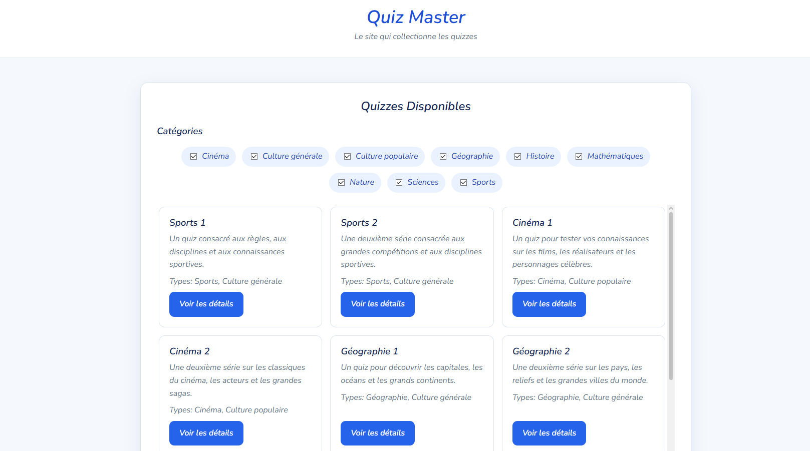
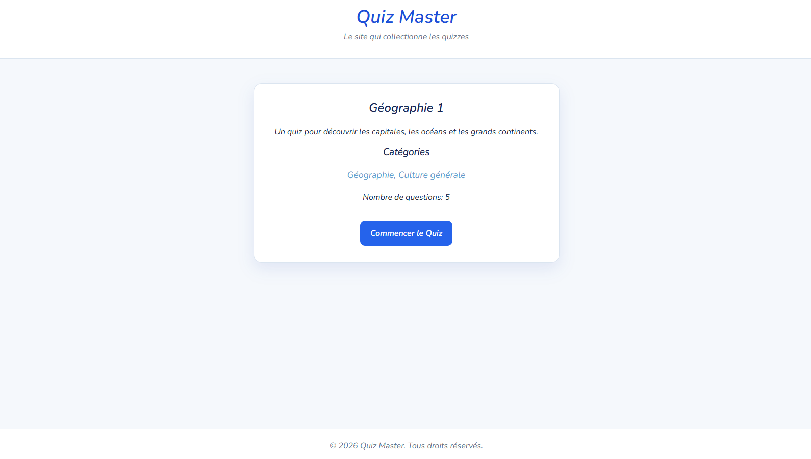
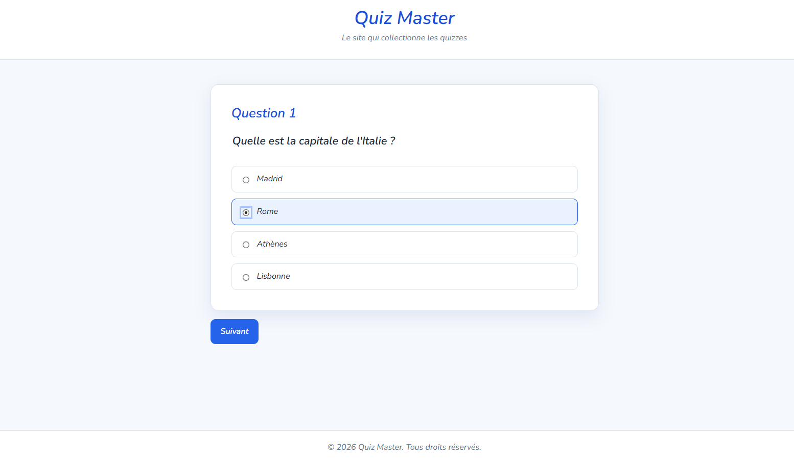
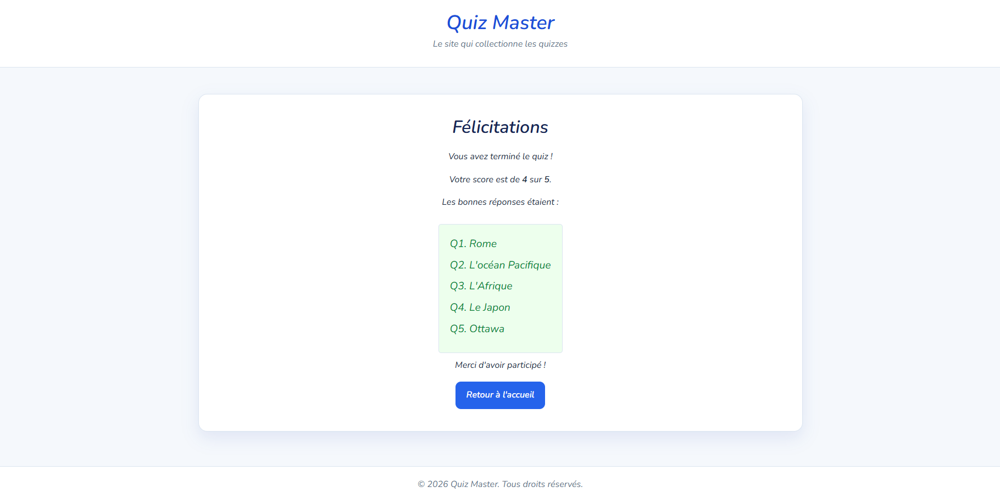

# Quiz Master

Quiz Master est une application web de quiz développée avec Angular. Elle propose plusieurs séries de questions sur des thèmes variés.

# Objectifs
D'un point de vue utilisateur, l'objectif derrière ce site est de proposer une plateforme ludique offrant des quiz afin de challenger les utilisateurs sur leurs connaissances.
D'un point de vue concepteur, l'objectif derrière ce projet était pour moi de me faire la main sur l'utilisation d'Angular dans le cadre de la conception d'un site web.

## Fonctionnalités

- Affichage des quiz disponibles depuis la page d'accueil.
- Filtrage des quiz par catégorie.
- Présentation du titre, de la description et du nombre de questions avant le démarrage.
- Navigation question par question.
- Sélection d'une réponse parmi plusieurs options.
- Activation des boutons de navigation uniquement après sélection d'une réponse.
- Calcul du score à la fin du quiz.
- Affichage du score, du total et des bonnes réponses.
- Page « À propos » présentant l'application.
- Page dédiée aux routes inexistantes.
- Rendu côté serveur avec Angular SSR.

## Aperçu

### Accueil



### Présentation d'un quiz



### Question



### Résultats



## Technologies utilisées

- Angular 22
- TypeScript
- HTML
- CSS
- Angular Router

Une partie du CSS a été générée avec l'aide d'une intelligence artificielle,
puis intégrée et adaptée au projet.

## Structure du projet

```text
public/
├── data/                       # Données des quiz au format JSON
└── img/                        # Captures utilisées dans la documentation

src/
├── app/
│   ├── components/
│   │   ├── quiz-details/       # Informations générales d'un quiz
│   │   ├── quiz-item/          # Carte d'un quiz sur l'accueil
│   │   └── quiz-question/      # Affichage d'une question et de ses options
│   ├── models/
│   │   └── quiz.models.ts      # Types Quiz et QuizInfos
│   ├── pages/
│   │   ├── about/              # Page À propos
│   │   ├── home/               # Liste et filtrage des quiz
│   │   ├── not-found/          # Page 404
│   │   ├── quiz/               # Déroulement d'un quiz
│   │   └── score/              # Résultats
│   ├── app.routes.ts           # Routes de l'application
│   └── quiz-result.ts          # Stockage temporaire du score et du total
├── main.ts                     # Point d'entrée navigateur
├── main.server.ts              # Point d'entrée serveur
└── server.ts                   # Serveur Angular SSR
```

## Données des quiz

Les quiz sont placés dans le dossier `public/data` et sont structurés sous la forme de fichiers .json :

```json
{
  "id": 2,
  "name": "Sports 1",
  "description": "Un quiz consacré aux connaissances sportives.",
  "kinds": ["Sports", "Culture générale"],
  "questions": [
    {
      "id": 1,
      "question": "Combien de joueurs une équipe de football aligne-t-elle ?",
      "options": ["9", "10", "11", "12"],
      "answer": 2
    }
  ]
}
```

## Routes principales

| Route | Description |
|---|---|
| `/` | Page d'accueil |
| `/home` | Page d'accueil |
| `/quiz/:id` | Déroulement d'un quiz |
| `/about` | Présentation de l'application |
| `/score` | Résultats du dernier quiz |
| `**` | Page non trouvée |

Le fichier du quiz est actuellement transmis à la page de quiz via le paramètre `file` de l'URL. Le score et le total sont stockés temporairement dans le service `QuizResult`.

## Limites connues

- Le score stocké dans `QuizResult` est perdu après un rechargement complet de
  la page ou une navigation directe vers `/score`.
- Les bonnes réponses sont encore transmises à la page de résultats via un
  paramètre d'URL.
- Le parcours actuel ne propose pas de bouton « Précédent ».
- La suite de tests doit encore être complétée pour couvrir tout le parcours
  utilisateur et les dépendances de la page des résultats.
- Les données JSON sont chargées depuis des fichiers statiques ; il n'y a pas
  de backend ni de compte utilisateur.

## Informations complémentaires
Ce site a été réalisé en environ 10 heures de travail. Cette plateforme n'a pas pour vocation à être déployée en ligne et n'a qu'un objectif pédagogique.
Ce projet avait avant tout pour but d'explorer les bases d'Angular dans le cadre de l'élaboration d'un site web.
